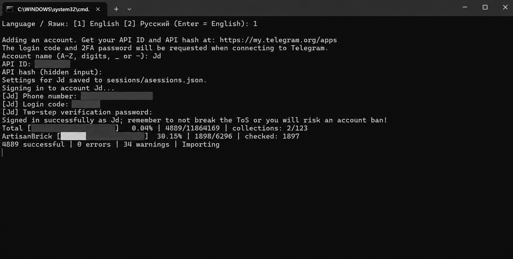
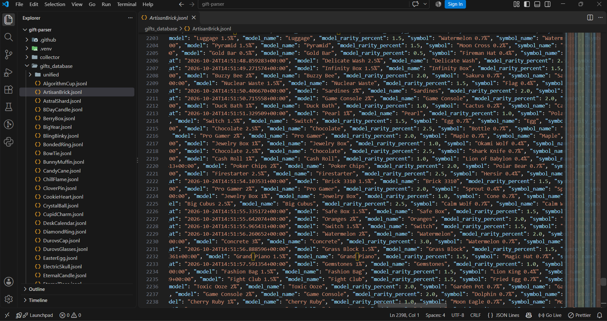

# Telegram Gift Parser

Версия **v0.1.0** · [История изменений](CHANGELOG.md)

[English](README.md) · **Русский**

Если вам нужны данные о коллекционных подарках Telegram в обычных файлах, этот парсер поможет их собрать. Он получает сведения через Telegram API и записывает их в JSONL: отдельно для каждой коллекции и в один общий файл.

Для работы понадобятся Python и ваш аккаунт Telegram. Платный сторонний API не нужен.

## Что можно собрать

Парсер сохраняет владельца, модель, фон, символ, тираж и время проверки подарка. Если Telegram не раскрывает имя владельца, в записи остаются доступные сведения — например, его ID.

Вы можете проверить один подарок, запустить сбор по найденным коллекциям или продолжить прерванную загрузку. Уже сохранённые номера при обычном запуске пропускаются. Для повторной проверки есть `--refresh`.

Сразу о пределах: парсер не обещает найти каждый существующий подарок. Некоторые коллекции не удаётся определить автоматически, а отдельные номера могут быть недоступны через API. Полученная база отражает состояние подарков на момент проверки; изменения владельцев сами по себе в неё не поступают.

## Как это выглядит

Добавление аккаунта и сбор подарков в консоли. Введённые данные на скриншоте скрыты.



Результат сохраняется в JSONL: у каждой коллекции свой файл, а общая база находится в папке `unified`.



## Рекомендация автора

Для больших объёмов я рекомендую использовать от **8 аккаунтов**: сбор распределяется между ними, и работа обычно идёт быстрее, чем с одним. Это рекомендация по организации сбора, а не гарантия скорости — результат зависит от доступности данных и ограничений Telegram.

Если парсер обнаружит критическую ошибку, потерю соединения или проблему с авторизацией, он остановит весь сбор. Для `FLOOD_WAIT` предусмотрен другой порядок: программа выдержит указанную Telegram паузу, после чего продолжит работу. Такая обработка помогает контролировать сбор, но не защищает аккаунты от ограничений или блокировки.

## Перед запуском — пожалуйста, прочитайте

В парсере предусмотрены паузы и остановка при обнаружении критических ошибок. Однако решения об ограничениях и блокировке аккаунтов принимает Telegram, и гарантировать, что ваш аккаунт не столкнётся с ними, я не могу. Поэтому перед запуском прошу учесть простое правило: **не используйте основные аккаунты**.

Для работы выбирайте отдельные дополнительные аккаунты, возможная потеря которых не затронет вашу переписку, контакты, подарки и другие важные данные. `FLOOD_WAIT` означает временное ограничение запросов; ожидание его окончания не гарантирует защиту от последующих ограничений. Используя парсер, вы принимаете эти риски и ответственность за свои аккаунты на себя. Как автор, я не могу гарантировать их сохранность.

## С чего начать

### Windows

Установите **Python 3.10 или новее** с [python.org](https://www.python.org/downloads/). При установке отметьте пункт **Add Python to PATH**.

Скачайте проект, распакуйте архив и откройте `START.bat` двойным нажатием. При первом запуске он подготовит окружение и установит зависимости. Затем программа предложит выбрать язык и добавить аккаунт.

Если запускаете из PowerShell, сначала перейдите в папку проекта и выполните:

```powershell
.\START.bat
```

Именно с `.\` в начале: так PowerShell запускает файл из текущей папки.

Если хотите установить всё вручную:

```powershell
py -3 -m venv .venv
.\.venv\Scripts\python.exe -m pip install -r requirements.txt
.\.venv\Scripts\python.exe .\gift-parser.py
```

Активировать окружение или менять ExecutionPolicy для этих команд не требуется.

### Linux и macOS

Откройте терминал в папке проекта:

```bash
python3 -m venv .venv
.venv/bin/python -m pip install -r requirements.txt
.venv/bin/python gift-parser.py
```

В примерах ниже приведены команды для Windows. На Linux и macOS используйте `.venv/bin/python gift-parser.py` с теми же аргументами.

## Как добавить аккаунт

При первом запуске программа сама запросит нужные данные.

1. Откройте [my.telegram.org/apps](https://my.telegram.org/apps), войдите в свой аккаунт и создайте приложение. На этой странице вы получите **API ID** и **API hash**.
2. Придумайте имя аккаунта для парсера, например `main`. Подойдут латинские буквы, цифры, `_` и `-`, всего до 64 символов.
3. Введите API ID и API hash в консоли. При вводе hash символы не отображаются — это нормально.
4. При подключении укажите номер телефона с кодом страны, код входа и пароль двухэтапной защиты, если он установлен. Код может прийти в Telegram, а не по SMS.

Настройки сохраняются в `sessions/asessions.json`, авторизация — в отдельном файле в папке `sessions`. При следующем запуске входить заново обычно не придётся. Если вы прервали авторизацию, программа повторит её при следующем запуске сбора.

Чтобы пока только добавить настройки аккаунта и не начинать сбор:

```powershell
.\START.bat --setup
```

Ещё один аккаунт можно добавить позже:

```powershell
.\START.bat --add-account
```

Посмотреть сохранённые имена или запустить сбор с конкретного аккаунта:

```powershell
.\START.bat --list-accounts
.\START.bat --account main
```

Список не показывает API-ключи. Если вы подключите один и тот же Telegram-аккаунт через разные сессии в общем запуске, программа остановится и сообщит об этом.

## Как выбрать язык

При первом запуске доступны русский и английский. Выбор сохраняется в `config.json`.

Чтобы изменить язык, остановите парсер и выполните в PowerShell:

```powershell
.\START.bat --lang ru
```

Для английского:

```powershell
.\START.bat --lang en
```

Это команды запуска, их не нужно вводить в работающий парсер. После смены языка программа продолжит обычный запуск. Если хотите только сохранить язык и выйти, добавьте `--list-accounts`:

```powershell
.\START.bat --lang en --list-accounts
```

Сообщения самой программы переведены. Ошибки, которые приходят от Telegram или Telethon, могут оставаться на английском. Названия полей в базе одинаковы для обоих языков.

## Первый сбор

Советую начать с одного подарка: так вы убедитесь, что аккаунт подключён и данные записываются.

```powershell
.\START.bat https://t.me/nft/PlushPepe-1 --single
```

Для обычного сбора по всем найденным коллекциям:

```powershell
.\START.bat
```

Если передать ссылку без `--single`, она задаст стартовую коллекцию, но не ограничит сбор одним подарком.

Для короткой проверки первых десяти номеров каждой найденной коллекции:

```powershell
.\START.bat --first 1 --last 10
```

Остановить сбор можно сочетанием **Ctrl+C**. Уже записанные данные останутся на диске. Чтобы продолжить, запустите ту же команду без `--refresh`.

## Где искать результат

| Путь | Что находится внутри |
|---|---|
| `gifts_database/<Collection>.jsonl` | Данные одной коллекции |
| `gifts_database/unified/unified.jsonl` | Общая база |
| `sessions/asessions.json` | API-настройки ваших аккаунтов |
| `sessions/*.session` | Сохранённая авторизация Telegram |
| `config.json` | Настройки запуска и язык |
| `logs/` | Журналы, каталог и состояние последнего запуска |

В JSONL каждая строка — отдельная JSON-запись. Файлы можно обрабатывать своими скриптами или импортировать в базу данных.

## Настройки

`config.json` появляется автоматически. В репозитории есть `config.example.json`, если хотите заранее посмотреть его структуру.

| Поле | По умолчанию | Для чего нужно |
|---|---|---|
| `language` | Выбирается при первом запуске | `ru` или `en`; Enter при выборе включает английский |
| `url` | `https://t.me/nft/PlushPepe-1` | Стартовый подарок и приоритетная коллекция |
| `scan` | `true` | Поиск коллекций; при `false` проверяется один подарок |
| `first` | `1` | Номер, с которого начинается сбор |
| `interval` | `0.3` | Минимальная пауза между запросами одного аккаунта в секундах |

Интервал можно задать на один запуск:

```powershell
.\START.bat --interval 1
```

Чтобы заново проверить сохранённые подарки:

```powershell
.\START.bat --refresh
```

При обновлении старые строки не удаляются: в файлы добавляются новые снимки. Если вам нужна последняя версия данных, выбирайте для каждого `slug` запись с наиболее поздним `checked_at`.

Аргумент `--scan` оставлен для совместимости. Он не переопределяет `scan: false` в настройках.

Все доступные аргументы:

```powershell
.\START.bat --lang ru --help
```

## Если что-то не работает

**Программа не понимает `--lang`.** Скорее всего, запускается старая версия. Обновите исходники, включая папку `collector`. Свою папку `sessions`, базу и `config.json` удалять не нужно.

**PowerShell не находит START.bat.** Проверьте, что открыли папку проекта, и используйте `.\START.bat`, а не просто `START.bat`.

**Ошибка API ID или API hash.** Сверьте данные с my.telegram.org. Остановите парсер и исправьте нужную запись в `sessions/asessions.json`.

**FloodWait.** Telegram попросил сделать паузу. Парсер дождётся указанного времени. Уменьшение интервала не гарантирует более быстрый сбор: ограничения зависят от Telegram.

**Пропало соединение или не удалось войти.** Сбор останавливается. Посмотрите `logs/errors.log`, устраните причину и повторите запуск.

**Повреждён файл аккаунтов.** Парсер не перезаписывает его. Исправьте JSON или сначала сохраните копию файла, а затем настройте аккаунты заново.

**Собрана не вся коллекция.** Посмотрите журналы: часть номеров может быть недоступна, а часть коллекций — не определена. Само по себе это не доказывает, что подарка нет.

Коды завершения: `0` — работа завершена, `2` — остались неполные коллекции, `1` — ошибка, `130` — остановка пользователем. Ошибка аргументов командной строки тоже может возвращать `2`; в таком случае ориентируйтесь на сообщение в консоли.

## Перед публикацией своих изменений

Не загружайте папку `sessions`: файлы сессий дают доступ к аккаунту, а API hash хранится в JSON открытым текстом. Журналы и личные выгрузки тоже лучше оставить у себя. Они уже исключены через `.gitignore`, но это не удаляет файлы, которые ранее попали в историю Git.

Если хотите удалить аккаунт из парсера, остановите программу, уберите его запись из `sessions/asessions.json` и соответствующий файл сессии. Отозвать саму авторизацию можно в Telegram: **Настройки → Устройства**.

Для проверки изменений:

```bash
python -m unittest discover -s tests -v
```

Тесты работают во временных папках и не подключаются к Telegram. Проверки GitHub Actions настроены для Windows и Linux.

Проект не связан с командой Telegram. Готовая база подарков и размещённый API в него не входят. Используя парсер, соблюдайте правила Telegram и требования к работе с данными.

## Лицензия и условия использования

Текущая публикация распространяется на условиях [личного некоммерческого использования](LICENSE).
Вы можете запускать неизменённый парсер для собственных некоммерческих задач и настраивать свои аккаунты. Для изменения кода, использования его в других проектах, распространения или коммерческой эксплуатации нужно предварительное письменное разрешение автора — если соответствующих прав у вас уже нет по другой применимой лицензии.

Ранее проект был опубликован под MIT. Эти разрешения сохраняются: смена лицензии не запрещает использование, изменение и коммерческое применение той прежней версии по MIT. Исходный текст MIT остаётся доступен в истории Git.

Теперь проект публикуется с доступным исходным кодом (source-available), а не под открытой лицензией. Зависимости сохраняют свои лицензии. Полные условия приведены на английском в LICENSE; этот раздел — их краткое пояснение.

---

Автор: **thugger / edytion** · [github.com/edytion](https://github.com/edytion)
